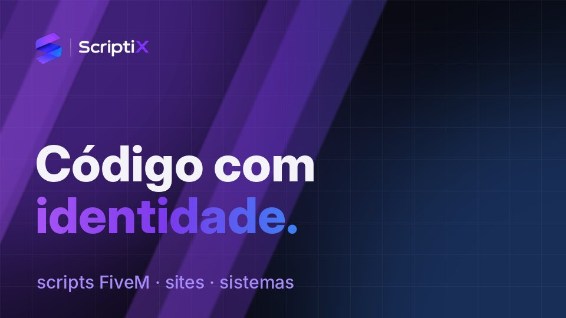
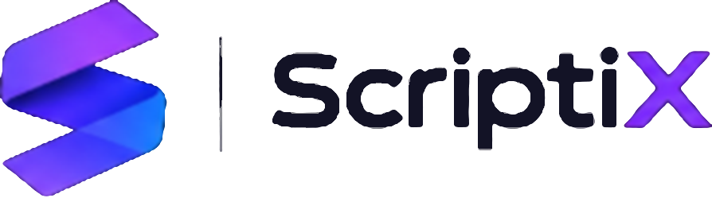
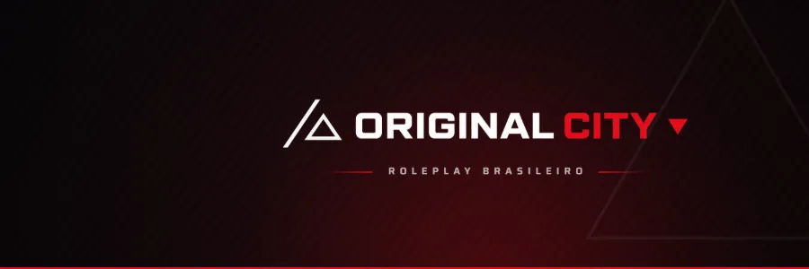

  

<picture>
  <source media="(prefers-color-scheme: dark)" srcset="assets/scriptix-logo-branca.png">
  
</picture>

### Desenvolvedor e fundador da **ScriptiX**
Scripts FiveM, sites e sistemas, com identidade própria e suporte em português.

---

## 👋 Sobre mim

Desenvolvo sistemas para servidores de roleplay em **FiveM** desde a base até a interface: frameworks **Qbox** e **QBCore**, celular, HUD, economia, mecânica, anticheat e painéis de administração. Pela **ScriptiX** também faço sites, lojas, bots de Discord e automações.

- 🏙️ Desenvolvo e mantenho a **Original City**, cidade de roleplay brasileira em Qbox
- 🧩 Scripts com prévia ao vivo, código limpo e tudo traduzido para o pt-BR
- 🛡️ Segurança em primeiro lugar: validação no servidor, sem confiar no cliente
- 💬 Atendimento e suporte em português

## 🛠️ Tecnologias

  
  
  
  
  
  
  
  
  

  
  
  
  
  
  

## 🚀 O que a ScriptiX faz

| | Serviço | |
|:-:|---|---|
| 🎮 | **Scripts FiveM** | HUD, celular (NPWD), mecânica, economia, empregos, crime, casas, corridas, anticheat |
| 🌐 | **Sites e lojas** | Sites rápidos, loja integrada à Tebex, landing pages |
| 🤖 | **Bots e automações** | Bots de Discord, integração jogo ↔ Discord, logs e painéis |
| 🧰 | **Sistemas sob medida** | Painéis de administração, dashboards e ferramentas internas |

## 🏙️ Projeto em destaque

**Original City**: servidor de roleplay brasileiro em FiveM (Qbox), com sistemas próprios escritos do zero:

`og_hud` · `og_chat` · `og_map` · celular com mais de 20 apps · `og_economia` · `og_mecanica` · `og_guard` (anticheat) · `og_empregos` · `og_painel` · casas · corridas

---

**ScriptiX** · código com identidade 
Feito pela ScriptiX

